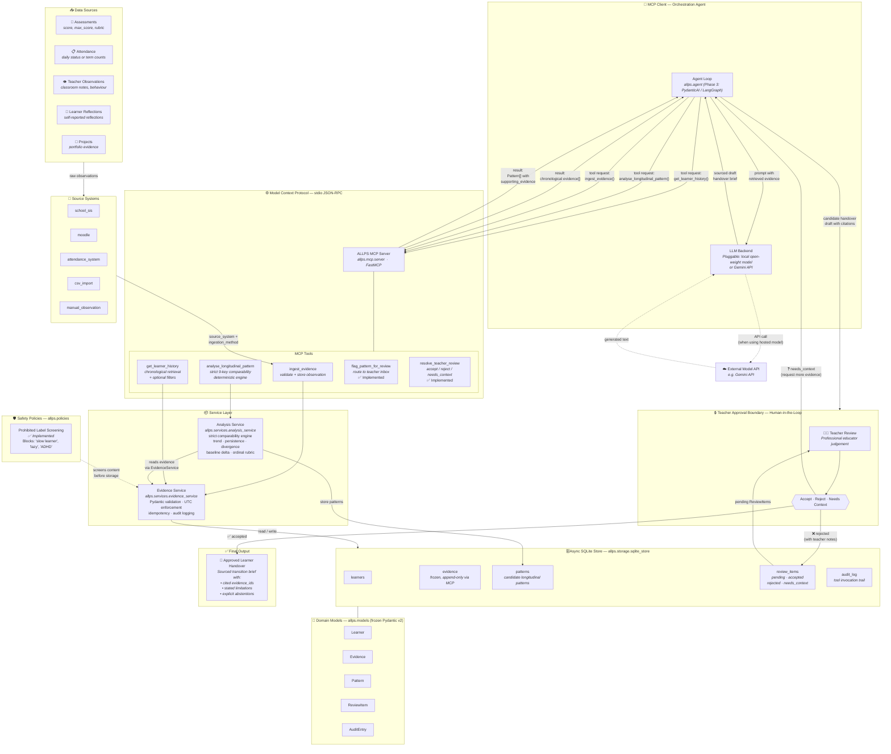

# ALLPS — System Architecture Map

> **Agentic Longitudinal Learner Profile System**
> Visual map of components, data flows, and approval boundaries

---

## Full System Flow Diagram



---

## Component Legend

| Symbol | Component | Module / Location | Status |
|--------|-----------|-------------------|--------|
| 📥 | **Data Sources** | 5 evidence types: `assessment`, `attendance`, `observation`, `learner_reflection`, `project` | ✅ Implemented |
| 🏫 | **Source Systems** | `source_system` field (`school_sis`, `moodle`, `attendance_system`, `csv_import`, etc.) | ✅ Implemented |
| 🤖 | **Orchestration Agent** | [`allps.agent`](file:///q:/ALLPS/src/allps/agent/__init__.py) — Bounded Pydantic AI orchestration | ✅ Implemented |
| 🧠 | **LLM Backend** | Pluggable: deterministic fallback, local open-weight model (`allps-qwen35-base-4b`), or hosted Gemini API | ✅ Implemented |
| ⚙️ | **MCP Server** | [`allps.mcp.server`](file:///q:/ALLPS/src/allps/mcp/server.py) — FastMCP, stdio transport | ✅ Implemented |
| 🔧 | **MCP Tools** | `ingest_evidence`, `get_learner_history`, `analyse_longitudinal_pattern` | ✅ Implemented |
| 🔧 | **Review Tools** | `flag_pattern_for_review`, `resolve_teacher_review`, `get_pending_reviews`, `get_surfaced_profile` | ✅ Implemented |
| 📦 | **Evidence Service** | [`allps.services.evidence_service`](file:///q:/ALLPS/src/allps/services/evidence_service.py) | ✅ Implemented |
| 📦 | **Analysis Service** | [`allps.services.analysis_service`](file:///q:/ALLPS/src/allps/services/analysis_service.py) | ✅ Implemented |
| 🗄️ | **SQLite Store** | [`allps.storage.sqlite_store`](file:///q:/ALLPS/src/allps/storage/sqlite_store.py) — async via `aiosqlite` | ✅ Implemented |
| 📐 | **Domain Models** | [`allps.models`](file:///q:/ALLPS/src/allps/models/__init__.py) — `Learner`, `Evidence`, `Pattern`, `ReviewItem`, `AuditEntry` | ✅ Implemented |
| 🛡️ | **Safety Policies** | [`allps.policies`](file:///q:/ALLPS/src/allps/policies/__init__.py) — prohibited label screening | ✅ Implemented |
| 🔒 | **Teacher Approval Gate** | [`ReviewItem`](file:///q:/ALLPS/src/allps/models/review.py) — `pending` → `accepted` / `rejected` / `needs_context` | ✅ Implemented & Enforced |
| ✅ | **Approved Handover** | Sourced transition brief with evidence citations, limitations, and SHA-256 snapshot | ✅ Implemented |
| ☁️ | **External Model API** | Local LM Studio endpoint (`allps-qwen35-base-4b`) + remote Gemini API support | ✅ Implemented |

---

## Flow Summary

```
┌──────────────────────────────────────────────────────────────────────────────┐
│                           END-TO-END DATA FLOW                              │
│                                                                              │
│   Assessments ─┐                                                             │
│   Attendance  ─┤                                                             │
│   Observations ┼─→ Source Systems ─→ ingest_evidence ─→ Evidence Service     │
│   Reflections ─┤       (provenance)      (MCP tool)      (validation)        │
│   Projects   ──┘                                                             │
│                                                       │                      │
│                                                       ▼                      │
│                                              ┌─── SQLite ───┐               │
│                                              │  evidence     │               │
│                                              │  patterns     │               │
│                                              │  review_items │               │
│                                              │  audit_log    │               │
│                                              └───────────────┘               │
│                                                       │                      │
│                                      ┌────────────────┘                      │
│                                      ▼                                       │
│   Agent ←── tool request ──→ MCP Server ──→ Services                         │
│     │   ←── tool result  ───┘                                                │
│     │                                                                        │
│     ├──→ LLM (Gemini API / local model)                                      │
│     │   ←── sourced draft ──┘                                                │
│     │                                                                        │
│     └──→ Candidate Handover Draft                                            │
│              │                                                               │
│              ▼                                                               │
│     ┌──────────────────────────────┐                                         │
│     │  🔒 TEACHER APPROVAL GATE   │                                         │
│     │    accept / reject /         │                                         │
│     │    needs_context             │                                         │
│     └──────────┬───────────────────┘                                         │
│                │                                                             │
│                ▼                                                             │
│     ✅ Approved Learner Handover                                             │
│        (cited evidence, limitations, abstentions)                            │
└──────────────────────────────────────────────────────────────────────────────┘
```

---

## Key Design Decisions

> [!IMPORTANT]
> **Teacher Approval Boundary**: No pattern enters the published learner profile unless a human teacher explicitly sets `ReviewItem.status = ACCEPTED`. Autonomous agents are prohibited from self-approving.

> [!NOTE]
> **Separate request/response arrows**: The agent sends tool requests to the MCP server and receives structured results back — these are distinct protocol messages over stdio JSON-RPC, not a single round-trip.

> [!TIP]
> **Deterministic fallback**: The analysis engine is fully deterministic (strict 9-key comparability, no LLM involved). The LLM is only used in the agent orchestration layer for natural-language synthesis of the handover brief.
